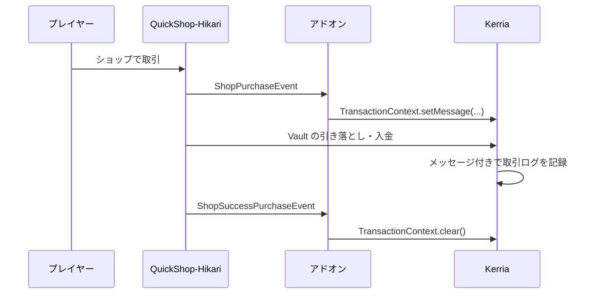

アドオンは、外部プラグインと Kerria を連携させるための、独立したプラグインです。
連携したいプラグインに対応するアドオンの JAR を、Kerria 本体と一緒に `plugins/` に配置して使用します。

| アドオン | 連携先 | 内容 |
|---------|-------|------|
| `Kerria-addon-quickshop-hikari` | [QuickShop-Hikari](https://modrinth.com/plugin/quickshop-hikari) | ショップでの購入・売却の内容を取引ログに記録する |

## QuickShop-Hikari

QuickShop-Hikari のショップでの取引は Vault 経由で行われるため、通常は取引ログに「QuickShop-Hikari による取引」であることしか記録されません。
このアドオンを導入すると、誰が・誰のショップで・何を・何個取引したかが、取引ログのメッセージとして記録されます。
記録された内容は `/kerria log` で確認できます。

### 導入方法

1. Kerria 本体と QuickShop-Hikari を導入します。
2. `Kerria-addon-quickshop-hikari-<version>.jar` を `plugins/` に配置します。
3. サーバーを再起動します。

[mpm](/docs/mpm-repository) を使っている場合は、`Kerria-addon-quickshop-hikari` をインストールすると、Kerria 本体と同じバージョンのアドオンが取得されます。

アドオンは Paper プラグインとして動作し、Kerria と QuickShop-Hikari の両方が必須です。どちらかが無い場合は読み込まれません。
設定ファイルはありません。

### 記録されるメッセージ

| 取引 | メッセージの例 |
|-----|--------------|
| 販売ショップでアイテムを購入 | `QuickShop: Steve が Notch のショップで diamond ×16 を購入` |
| 買取ショップへアイテムを売却 | `QuickShop: Steve が Notch のショップに diamond ×16 を売却` |

アイテムに独自の名前が付いている場合はその名前が、付いていない場合はアイテムの ID（`diamond` など）が使われます。

1 回の取引で、購入者の引き落とし・オーナーへの入金がそれぞれ別の取引ログとして記録されます。
どちらの取引ログにも同じメッセージが付くため、購入者・オーナーのどちらの履歴からでも取引の内容を確認できます。

### 仕組み

QuickShop-Hikari は 1 回の取引を同じスレッドで順に処理するため、取引前のイベントで [`TransactionContext`](/docs/api#transaction-context) にメッセージを設定し、取引後のイベントで解除しています。

取引が途中で失敗して取引後のイベントが呼ばれなかった場合も、次の tick でメッセージを解除するため、後続の取引に誤ったメッセージが付くことはありません。
