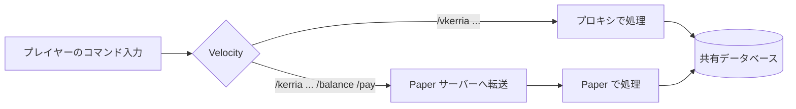

Kerria のコマンドは、**Paper サーバー上で実行するコマンド**（`/kerria ...`）と、**プロキシ（Velocity）上で実行するコマンド**（`/vkerria ...`）の 2 種類に分かれています。
`<param>` は必須パラメータ、`[param]` はオプションパラメータを示します。

プレイヤー向けのコマンド（`/balance`・`/pay`・`/kerria log` など）は[プレイヤー向けコマンド](/docs/player/commands)を参照してください。

## コマンド一覧

| コマンド | 実行場所 | 説明 | パーミッション |
|---------|---------|------|--------------|
| `/kerria set <player> <amount> [currencyId] [--message <message>]` | Paper | 残高を直接設定する | `kerria.admin.economy` |
| `/kerria give <player> <amount> [currencyId] [--message <message>]` | Paper | 残高を付与する | `kerria.admin.economy` |
| `/kerria take <player> <amount> [currencyId] [--message <message>]` | Paper | 残高を徴収する | `kerria.admin.economy` |
| `/kerria log player <player> [page]` | Paper | 他のプレイヤーの取引履歴を表示する | `kerria.admin.log` |
| `/kerria log clear <days> [--confirm]` | Paper | 古い取引ログを削除する | `kerria.admin.log` |
| `/kerria top [currencyId] [page]` | Paper | 残高ランキングを表示する | `kerria.top` |
| `/kerria currency create <name> <symbol> [decimals]` | Paper | 通貨を作成する | `kerria.admin.currency` |
| `/kerria currency edit <name> <property> <newValue>` | Paper | 通貨のプロパティを変更する | `kerria.admin.currency` |
| `/kerria currency default <name>` | Paper | デフォルト通貨を変更する | `kerria.admin.currency` |
| `/kerria currency delete <name>` | Paper | 通貨を削除する | `kerria.admin.currency` |
| `/kerria currency list` | Paper | 通貨の一覧を表示する | `kerria.admin.currency` |
| `/kerria currency info <name>` | Paper | 通貨の詳細を表示する | `kerria.admin.currency` |
| `/kerria rate set <fromCurrency> <toCurrency> <rate>` | Paper | 為替レートを設定する | `kerria.admin.currency` |
| `/kerria rate delete <fromCurrency> <toCurrency>` | Paper | 為替レートを削除する | `kerria.admin.currency` |
| `/kerria rate list` | Paper | 為替レートの一覧を表示する | `kerria.admin.currency` |
| `/kerria reload` | Paper | 設定ファイルとメッセージファイルを再読み込みする | `kerria.admin.reload` |
| `/vkerria balance` | プロキシ（Velocity） | 自分の残高を表示する | なし |
| `/vkerria pay <player> <amount>` | プロキシ（Velocity） | 他のプレイヤーへ送金する | なし |

### `/kerria` と `/vkerria` を分けている理由

Velocity では、プロキシに登録されたコマンドがバックエンドの Paper サーバーより先に処理されます。
プロキシ側のコマンドも `/kerria` という名前にすると、プレイヤーが入力した `/kerria ...` をすべてプロキシが受け取ってしまい、Paper 側の `/kerria` が実行できなくなります。
そのため、プロキシ側のコマンドは `/vkerria` という別の名前で登録しています。



## Paper サーバーのコマンド

以下のコマンドは Paper サーバー上で実行します。すべて適切なパーミッションが必要です（パーミッションの既定値は[パーミッション](/docs/permissions)を参照してください）。

### 残高操作

プレイヤーの残高を直接操作するコマンドです。

:::info[オフラインプレイヤーの指定]
`<player>` にはオフラインプレイヤーも指定できます。Kerriaのアカウントを持つプレイヤーであれば、サーバーのプロファイルキャッシュに存在しなくても名前で解決されます（大文字小文字は区別しません）。
:::

:::info[セレクタの指定]
`<player>` には `@a` や `@a[distance=..10]` などのセレクタも指定できます。セレクタに該当するオンラインプレイヤーのうち、Kerriaのアカウントを持つプレイヤー全員が対象になります。
複数のプレイヤーが対象の場合は、個別の結果の代わりに成功件数がまとめて表示されます。
:::

:::info[取引メッセージ]
`--message` を指定すると、取引ログに記録するメッセージを指定できます。省略時は `Admin give by <実行者>` のような既定のメッセージが記録されます。
`/kerria give` のメッセージは [MiniMessage](https://docs.advntr.dev/minimessage/format.html) 形式に対応しており、受取人がオンラインの場合に受取通知とともに表示されます。
`/kerria set` と `/kerria take` のメッセージはプレーンテキストとして扱われ、MiniMessage のタグは解釈されません。
取引履歴（`/kerria log`）では、色や装飾などのタグのみが解釈されます。最大 512 文字まで指定できます。
:::

#### 残高設定

<CommandLine command={{
  command: "/kerria set <player> <amount> [currencyId] [--message <message>]",
  aliases: [],
  status: "stable"
}} />

指定したプレイヤーの残高を直接設定します。

- **パーミッション:** `kerria.admin.economy`

#### 残高付与

<CommandLine command={{
  command: "/kerria give <player> <amount> [currencyId] [--message <message>]",
  aliases: [],
  status: "stable"
}} />

指定したプレイヤーに金額を付与します。
受取人がオンラインの場合は、受け取った金額と `--message` のメッセージが通知されます。

```
/kerria give @a 100 --message <gold>イベント参加報酬
```

- **パーミッション:** `kerria.admin.economy`

#### 残高徴収

<CommandLine command={{
  command: "/kerria take <player> <amount> [currencyId] [--message <message>]",
  aliases: [],
  status: "stable"
}} />

指定したプレイヤーから金額を徴収します。残高が不足している場合はエラーになります。

- **パーミッション:** `kerria.admin.economy`

### 取引履歴

#### 取引履歴の閲覧

<CommandLine command={{
  command: "/kerria log player <player> [page]",
  aliases: [],
  status: "stable"
}} />

指定したプレイヤーの取引履歴を表示します。

- **パーミッション:** `kerria.admin.log`

#### 取引ログの削除

<CommandLine command={{
  command: "/kerria log clear <days> [--confirm]",
  aliases: [],
  status: "stable"
}} />

指定した日数より前の取引ログを削除し、データベースの肥大化を防ぎます。
`--confirm` を付けずに実行すると、削除対象の件数と確認用のリンクが表示されます。リンクをクリックするか、`--confirm` を付けて再実行すると削除されます。

```
/kerria log clear 90
/kerria log clear 90 --confirm
```

日数には 1 以上の整数を指定します。削除した取引ログは元に戻せません。
取引ログの保存先については[データベース](/docs/database)を参照してください。

- **パーミッション:** `kerria.admin.log`

### ランキング

<CommandLine command={{
  command: "/kerria top [currencyId] [page]",
  aliases: [],
  status: "stable"
}} />

残高ランキングを表示します。
通貨IDやページ番号を指定してフィルタリングできます。1ページあたり10件表示され、次ページへのクリック可能なリンクが表示されます。
引数は順番で判定されるため、通貨IDを省略してページ番号だけを指定することはできません（`/kerria top 2` は「通貨ID 2 の 1 ページ目」になります）。別のページを見る場合は、`/kerria top 1 2`（通貨ID 1 の 2 ページ目）のように通貨IDも指定してください。次ページへのリンクをクリックすると `/kerria top <currencyId> <page>` が実行されます。

- **パーミッション:** `kerria.top`（他のプレイヤーの残高が見えるため、デフォルトでは OP のみ。全員に公開する場合はパーミッション管理プラグインで付与してください）

### 通貨管理

#### 通貨作成

<CommandLine command={{
  command: "/kerria currency create <name> <symbol> [decimals]",
  aliases: [],
  status: "stable"
}} />

新しい通貨を登録します。
`decimals` は小数点以下の桁数で、省略時は 2 になります。
フォーマットはデフォルトで `%amount% <name>` が設定されます。

フォーマットでは `%amount%`（桁区切り済みの金額）・`%plural%`・`%symbol%`・`%name%` のプレースホルダが利用できます。桁区切り文字や小数点記号は、後述の `/kerria currency edit` で `thousandsSeparator` / `decimalSeparator` を変更して通貨ごとに調整できます。表示例は[設定ファイル](/docs/configuration#通貨の表示形式)を参照してください。

- **パーミッション:** `kerria.admin.currency`

#### 通貨編集

<CommandLine command={{
  command: "/kerria currency edit <name> <property> <newValue>",
  aliases: [],
  status: "stable"
}} />

既存の通貨のプロパティを、削除・再作成せずに変更します。
プロパティ名の大文字小文字は区別しません。

編集できるプロパティは以下の通りです。

| プロパティ | 説明 |
|-----------|------|
| `name` | 通貨名 |
| `plural` | 通貨の複数形 |
| `symbol` | 通貨記号 |
| `format` | フォーマットパターン |
| `fractionalDigits`（`decimals` でも可） | 小数点以下の桁数（0 以上の整数） |
| `thousandsSeparator` | 桁区切り文字 |
| `decimalSeparator` | 小数点記号 |

例えば `/kerria currency edit JPY symbol ￥` とすると、JPY の記号を変更できます。
別の通貨と同じ名前には変更できません。

- **パーミッション:** `kerria.admin.currency`

#### デフォルト通貨の変更

<CommandLine command={{
  command: "/kerria currency default <name>",
  aliases: [],
  status: "stable"
}} />

デフォルト通貨を、設定ファイルを直接編集せずに実行時に変更します。
指定した通貨のIDが設定ファイルの `economy.default-currency-id` に書き込まれ、以降のデフォルト通貨として使用されます。

通貨の名前・記号・フォーマットなどはデータベースで管理されているため、Vault 連携でもデータベース上の通貨の情報がそのまま使用されます。

:::warning[プロキシの設定は自動で更新されません]
このコマンドが書き換えるのは、実行した Paper サーバーの設定ファイルだけです。
プロキシ（Velocity）の `default-currency-id` は自動では更新されないため、`/vkerria` で扱う通貨を合わせる場合は手動で同じ値に変更してください。詳しくは[クロスサーバー](/docs/cross-server)を参照してください。
:::

- **パーミッション:** `kerria.admin.currency`

#### 通貨削除

<CommandLine command={{
  command: "/kerria currency delete <name>",
  aliases: [],
  status: "stable"
}} />

通貨を削除します。デフォルト通貨は削除できません。

- **パーミッション:** `kerria.admin.currency`

#### 通貨一覧

<CommandLine command={{
  command: "/kerria currency list",
  aliases: [],
  status: "stable"
}} />

登録されている全通貨の一覧を表示します。ID・名前・記号・小数桁数が確認できます。

- **パーミッション:** `kerria.admin.currency`

#### 通貨詳細

<CommandLine command={{
  command: "/kerria currency info <name>",
  aliases: [],
  status: "stable"
}} />

指定した通貨の詳細情報を表示します。フォーマット設定や表示例も確認できます。

- **パーミッション:** `kerria.admin.currency`

### 為替レート

#### 為替レート設定

<CommandLine command={{
  command: "/kerria rate set <fromCurrency> <toCurrency> <rate>",
  aliases: [],
  status: "stable"
}} />

通貨ペアの為替レートを設定します。
例えば、`/kerria rate set JPY USD 0.0067` とすると、1 JPY = 0.0067 USD になります。

- **パーミッション:** `kerria.admin.currency`

#### 為替レート削除

<CommandLine command={{
  command: "/kerria rate delete <fromCurrency> <toCurrency>",
  aliases: [],
  status: "stable"
}} />

設定されている通貨ペアの為替レートを削除します。削除したペアでは通貨変換ができなくなります。
指定したペアにレートが設定されていない場合はエラーになります。

- **パーミッション:** `kerria.admin.currency`

#### 為替レート一覧

<CommandLine command={{
  command: "/kerria rate list",
  aliases: [],
  status: "stable"
}} />

設定されている全ての為替レートを一覧表示します。通貨ペアと設定されたレートが確認できます。

- **パーミッション:** `kerria.admin.currency`

### プラグイン管理

#### 再読み込み

<CommandLine command={{
  command: "/kerria reload",
  aliases: [],
  status: "stable"
}} />

サーバーを再起動せずに、設定ファイル (`config.conf`) とメッセージファイル (`translation/*.properties`) をディスクから再読み込みします。
不正な内容の場合は再読み込みがスキップされ、直前の正常な内容が維持されます。

- **パーミッション:** `kerria.admin.reload`

## プロキシ（Velocity）のコマンド

以下のコマンドは Velocity プロキシ上で実行します。プロキシに Kerria（Velocity 版）を導入し、Paper サーバーと同じデータベースに接続している場合に利用できます。導入方法は[クロスサーバー](/docs/cross-server)を参照してください。

プロキシ上で処理されるため、プレイヤーがどのサーバーにいても実行でき、送金相手が別のサーバーにいても送金できます。
扱う通貨は、プロキシの設定ファイルの `default-currency-id` で指定した通貨に固定されます。

:::note
`/vkerria` のコマンドはパーミッションを確認しません。プロキシに接続しているプレイヤーであれば誰でも実行できます。
また、コンソールからは実行できません（プレイヤーのみ実行できます）。
サブコマンドを指定せずに `/vkerria` を実行した場合や、存在しないサブコマンドを指定した場合は、使い方（`Usage: /vkerria <balance|pay>`）が表示されます。
:::

### 残高確認

<CommandLine command={{
  command: "/vkerria balance",
  aliases: [],
  status: "stable"
}} />

自分の残高を、プロキシの `default-currency-id` の通貨で表示します。

- **パーミッション:** なし

### 送金

<CommandLine command={{
  command: "/vkerria pay <player> <amount>",
  aliases: [],
  status: "stable"
}} />

指定したプレイヤーに送金します。送金元からの減算と送金先への加算は、1 つのトランザクションでまとめて実行されます。

- `<player>` は Kerria のアカウント名で解決されます（大文字小文字は区別しません）。オフラインのプレイヤーにも送金できます。
- `<amount>` には 0 より大きい数値を指定します。
- 自分自身には送金できません。残高が不足している場合はエラーになります。
- 送金相手がプロキシに接続している場合は、受け取りの通知が届きます。

```
/vkerria pay Notch 100
```

:::warning[Paper の `/pay` との違い]
`/vkerria pay` は通貨IDや `--message` を指定できず、現在は取引ログ（`/kerria log` で表示される履歴）にも記録されません。
メッセージも英語の固定文言で表示され、[メッセージファイル](/docs/messages)の設定は反映されません。
:::

- **パーミッション:** なし

:::note
Velocity 版が提供するのは残高確認と送金のみです。通貨管理・残高操作・取引履歴などの管理コマンドは Paper サーバー上の `/kerria` で操作してください。
:::
