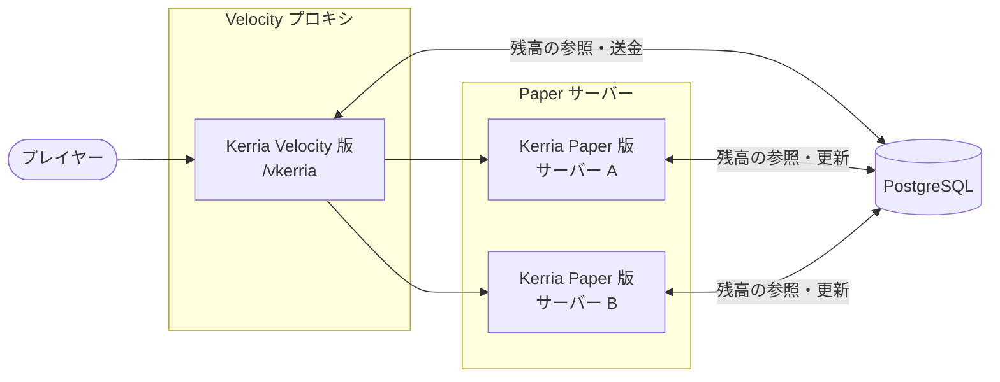

Kerria は Velocity プロキシ環境で、サーバーをまたいで残高を共有できます。

## 仕組み

Kerria の残高はすべてデータベースに保存されます。複数の Paper サーバーと Velocity プロキシが**同じ PostgreSQL データベース**を共有することで、どのサーバーからでも同じ残高を参照・更新できます。



Kerria はモジュールごとに役割が分かれています。

| モジュール | 役割 |
|-----------|------|
| `common` | データベースのテーブル・共有ロジック |
| `paper` | Paper サーバー用プラグイン |
| `velocity` | Velocity プロキシ用プラグイン |

`common` モジュールがデータベースアクセスを担うため、Paper と Velocity は同じスキーマ・同じ残高を扱います。
テーブルの構造については[データベース](/docs/database)を参照してください。

:::info[設計方針]
クロスサーバーの残高共有は、**共有データベース**方式を採用しています。残高の正本はデータベースにあり、各サーバーは都度データベースを参照します。プラグインメッセージや Redis などのメッセージング方式は採用していません。
:::

## 必要環境

- **PostgreSQL**（SQLite はファイルベースのため共有できません）
- Kerria を導入したすべての Paper サーバーと Velocity プロキシが、同じ PostgreSQL に接続していること

## 導入手順

1. Paper サーバー側の Kerria で、データベースを PostgreSQL に設定します（[データベース](/docs/database)を参照）。
2. Velocity プロキシの `plugins/` に Velocity 版の Kerria（`Kerria-velocity-<version>.jar`）を配置します。
3. プロキシを起動すると、`plugins/kerria/config.conf`（HOCON 形式）が生成されます。Paper 側と**同じ PostgreSQL** を指定して、プロキシを再起動してください。

```hcl
# 既定の通貨ID（Paper 側の economy.default-currency-id と同じ値にする）
default-currency-id = 1

database {
  # データベースの種類（sqlite | postgresql）
  mode = "postgresql"
  host = "localhost"
  port = 5432
  database = "kerria"
  username = "user"
  password = "password"
}
```

Paper 側と同様に、`database.pool` セクションで HikariCP の接続プールを調整できます。各項目については[データベース](/docs/database)を参照してください。
また、HOCON の置換を使うと環境変数から値を読み込めます（例: `password = ${?KERRIA_DB_PASSWORD}`）。

通貨の名前・記号・フォーマットは共有データベースから読み込まれるため、プロキシ側で設定する必要はありません。
ただし、デフォルト通貨のIDはサーバーごとの設定ファイルに保存されます。Paper 側で `/kerria currency default` を実行しても、プロキシ側の `default-currency-id` は自動で更新されないため、同じ値になるように手動で合わせてください。

:::warning
プロキシの起動時にデータベースへ接続できなかった場合、Velocity 版の Kerria は無効になり、`/vkerria` コマンドは登録されません。プロキシのログを確認してください。
:::

## プロキシコマンド

Velocity 上では、`/vkerria` コマンドが利用できます。

| コマンド | 説明 |
|---------|------|
| `/vkerria balance` | 自分の残高（`default-currency-id` の通貨）を表示します |
| `/vkerria pay <player> <amount>` | 他のプレイヤーへ送金します |

これらはプロキシ上で動作するため、送金相手が別のサーバーにいても送金できます。送金相手がプロキシに接続していれば、受け取りの通知が届きます。
いずれのコマンドもプレイヤーのみが実行でき、コンソールからは実行できません。

:::warning[Paper の `/pay` との違い]
`/vkerria pay` は通貨IDや `--message` を指定できず、現在は取引ログに記録されないため `/kerria log` にも表示されません。詳しくは[管理者コマンド](/docs/commands#プロキシvelocityのコマンド)と[プレイヤー向けコマンド](/docs/player/commands#proxy-pay)を参照してください。
:::

:::info[/kerria ではなく /vkerria である理由]
Velocity プロキシは、プレイヤーが入力したコマンドを Paper サーバーへ転送する前に処理します。
そのため、プロキシに Paper と同じ `/kerria` を登録すると、プロキシ側のコマンドが優先され、Paper サーバーの `/kerria`（`/kerria top` や管理者用コマンドなど）が実行できなくなります。
これを避けるため、プロキシのコマンドは `/vkerria` という別のラベルで登録しています。
:::

:::note
Velocity 版は現在、残高照会と送金の基本機能を提供します。通貨管理や取引履歴などの管理コマンドは Paper 側の `/kerria` で操作してください。
Paper と Velocity のコマンドの一覧は[コマンド](/docs/commands)を参照してください。
:::
