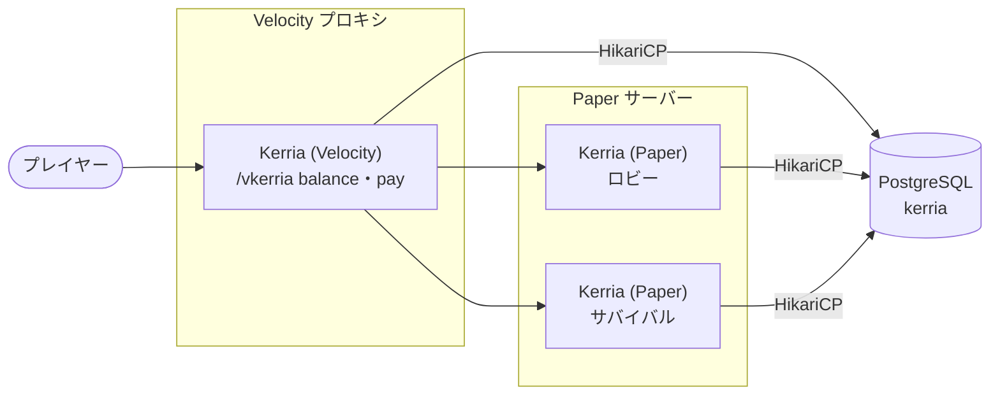

Kerria は、アカウント・残高・通貨・取引履歴などのすべてのデータをデータベースに保存します。
データベースの設定は `config.conf` の `database` ブロックに記述します。

## 対応しているデータベース

| 種類 | `database.mode` | 向いている構成 | 説明 |
|------|-----------------|----------------|------|
| SQLite | `sqlite` | Paper サーバー 1 台だけで運用する場合 | プラグインのデータディレクトリにファイルとして保存します。追加のサーバーは不要です。 |
| PostgreSQL | `postgresql` | 複数の Paper サーバーや Velocity でデータを共有する場合 | 外部の PostgreSQL サーバーに保存します。HikariCP による接続プールが自動的に有効になります。 |

`sqlite` と `postgresql` 以外の値を指定した場合は、`Invalid database type` というログが出力され、データベースに接続しません。
この場合、Paper では経済機能が正しく動作せず、Velocity ではサーバー間の経済機能が無効になります。

<Callout type="info">
SQLite のデータベースファイルは、各プラグインのデータディレクトリに個別に作成されます。
そのため、SQLite では複数のサーバー間でデータを共有できません。
Velocity を含めて残高を共有する場合は、すべてのサーバーで同じ PostgreSQL データベースを指定してください。
詳しくは [サーバー間連携](/docs/cross-server) を参照してください。
</Callout>

## 構成図

複数の Paper サーバーと Velocity プロキシで残高を共有する場合は、次のような構成になります。



Paper 版と Velocity 版の Kerria は、同じテーブル定義を使って同じデータベースへ接続します。
どちらの環境で行った送金も、同じ `accounts` / `account_balances` テーブルに反映されます。

## 設定

Paper 版の `config.conf` には、次の `database` ブロックが記述されています。

```hcl
database {
  # データベースの種類（sqlite | postgresql）
  mode = "sqlite"
  host = "localhost"
  port = 5432
  database = "kerria"
  username = "user"
  password = "password"

  # HikariCP の接続プール設定（PostgreSQL 使用時に有効）
  pool {
    # 最大コネクション数
    maximum-pool-size = 10
    # 最小アイドルコネクション数
    minimum-idle = 2
    # 接続タイムアウト（ミリ秒）
    connection-timeout = 30000
    # アイドルタイムアウト（ミリ秒）
    idle-timeout = 600000
    # コネクションの最大生存時間（ミリ秒）
    max-lifetime = 1800000
  }
}
```

:::info[Velocity 版の初期値]
Velocity 版の `config.conf` は、サーバー間でデータを共有することを前提としているため、`mode` の初期値が `"postgresql"` になっています。
その他のキーと初期値は Paper 版と同じです。
:::

### 設定項目

| キー | デフォルト | SQLite | PostgreSQL | 説明 |
|------|-----------|:------:|:----------:|------|
| `database.mode` | `"sqlite"` | ✓ | ✓ | 使用するデータベースの種類です。`sqlite` または `postgresql` を指定します。 |
| `database.host` | `"localhost"` | - | ✓ | PostgreSQL サーバーのホスト名またはアドレスです。 |
| `database.port` | `5432` | - | ✓ | PostgreSQL サーバーのポートです。 |
| `database.database` | `"kerria"` | ✓ | ✓ | PostgreSQL ではデータベース名です。SQLite ではファイル名 (`<database>.db`) に使用されます。 |
| `database.username` | `"user"` | - | ✓ | 接続に使用するユーザー名です。 |
| `database.password` | `"password"` | - | ✓ | 接続に使用するパスワードです。 |
| `database.pool.maximum-pool-size` | `10` | - | ✓ | 接続プールの最大コネクション数です。 |
| `database.pool.minimum-idle` | `2` | - | ✓ | 接続プールに保持する最小アイドルコネクション数です。 |
| `database.pool.connection-timeout` | `30000` | - | ✓ | コネクションを取得するまでのタイムアウト (ミリ秒) です。 |
| `database.pool.idle-timeout` | `600000` | - | ✓ | アイドル状態のコネクションを閉じるまでの時間 (ミリ秒) です。 |
| `database.pool.max-lifetime` | `1800000` | - | ✓ | コネクションの最大生存時間 (ミリ秒) です。 |

`-` の項目は、そのデータベースでは使用されず、無視されます。
その他の設定項目については [設定](/docs/configuration) を参照してください。

### SQLite を使用する

`mode = "sqlite"` の場合、データベースファイルはプラグインのデータディレクトリに `<database>.db` という名前で作成されます。
初期設定では、次の場所に作成されます。

| 環境 | ファイルの場所 |
|------|----------------|
| Paper | `plugins/Kerria/kerria.db` |
| Velocity | `plugins/kerria/kerria.db` |

SQLite では接続プールを使用せず、ファイルへ直接接続します。
コマンドは非同期に並行して実行されるため、同時書き込みで失敗しないように、次の接続オプションを自動的に設定しています。

| オプション | 説明 |
|-----------|------|
| `transaction_mode=IMMEDIATE` | トランザクションの開始時に書き込みロックを取得し、読み取りから書き込みへの昇格による競合を防ぎます。 |
| `busy_timeout=10000` | ロック中はすぐに失敗せず、最大 10 秒間解放を待ちます。 |
| `journal_mode=WAL` | 書き込み中も読み取りをブロックしないようにします。 |

### PostgreSQL を使用する

PostgreSQL を使用する場合は、事前にデータベースとユーザーを作成しておきます。

```sql
CREATE USER kerria WITH PASSWORD 'password';
CREATE DATABASE kerria OWNER kerria;
```

テーブルはプラグインが自動的に作成するため、ユーザーにはテーブルを作成・変更する権限が必要です。
`config.conf` には次のように記述します。

```hcl
database {
  mode = "postgresql"
  host = "db.example.com"
  port = 5432
  database = "kerria"
  username = "kerria"
  password = "password"
}
```

接続には `jdbc:postgresql://<host>:<port>/<database>` という URL が使用され、`kerria-pool` という名前の HikariCP 接続プールが作成されます。
接続に成功すると、`PostgreSQL database connected with HikariCP! (pool: 10 max, 2 idle)` のようなログが出力されます。

## テーブルの作成とマイグレーション

Kerria は、起動時にデータベースへ接続した後、次の処理を自動的に行います。

1. **テーブルの作成**: 存在しないテーブルを作成します。既に存在するテーブルはそのまま使用します。
2. **スキーマの差分の適用**: Exposed の `MigrationUtils` を使用して、既存のテーブルとプラグインのテーブル定義を比較し、差分を解消する SQL を実行します。プラグインのアップデートでカラムが追加された場合も、手動で SQL を実行する必要はありません。
3. **初期通貨の作成 (Paper のみ)**: `currencies` テーブルに通貨が 1 つも無い場合は、初期通貨 `JPY` を作成します。Velocity 版はテーブルの作成と差分の適用のみを行い、初期通貨は作成しません。

<Callout type="warn">
差分の適用では、カラムの追加だけでなく、テーブル定義に存在しないカラムやインデックスの削除も行われる場合があります。
Kerria のテーブルに独自のカラムやインデックスを追加しないでください。
</Callout>

初期通貨の値は次のとおりです。作成後の変更は `/kerria currency edit` で行います (詳しくは [コマンド](/docs/commands) を参照してください)。

| 項目 | 値 |
|------|----|
| 名前 (`name`) | `JPY` |
| 記号 (`sign`) | `¥` |
| 複数形 (`plural`) | `円` |
| フォーマット (`format`) | `%amount% %plural%` |
| 小数点以下の桁数 (`fractional_digits`) | `2` |
| 桁区切り文字 (`thousands_separator`) | `,` |
| 小数点記号 (`decimal_separator`) | `.` |

## UUID の種類

Kerria のテーブルには、意味の異なる 2 種類の UUID が保存されています。
どちらも `xxxxxxxx-xxxx-xxxx-xxxx-xxxxxxxxxxxx` という同じ形式であるため、次の表でどちらの UUID かを確認してください。

| 種類 | バージョン | 発行元 | 保存されているカラム | 例 |
|------|-----------|--------|----------------------|----|
| Kerria のアカウント ID | UUID v7 | Kerria (アカウント作成時に自動採番) | `accounts.id`、および `account_balances.account_id`、`transaction_logs.from_account_id` / `to_account_id`、`bank_members.bank_account_id` | <UUIDV7 /> |
| Minecraft のプレイヤー UUID | UUID v4 | Mojang (プレイヤーごとに固定) | `accounts.player_unique_id`、`bank_members.member_unique_id` | <MinecraftUUID name="Notch" /> |

アカウント ID は、先頭に作成時刻 (ミリ秒) を含む UUID v7 で採番されます。
そのため、3 つ目のブロックの先頭の数字 (バージョン) が `7` であれば Kerria のアカウント ID、`4` であれば Minecraft のプレイヤー UUID です。

:::warning[以前のバージョンで作成されたアカウント]
以前のバージョンの Kerria で作成されたアカウントの ID は UUID v4 のまま変更されません。
既存のデータが混在している場合は、バージョンではなくカラム名で区別してください。
:::

:::note
アカウント ID は、プレイヤーだけでなくサーバー・プラグイン・銀行などのアカウントにも割り当てられます。
プレイヤーのアカウントでは、アカウント ID とは別に `player_unique_id` に Minecraft のプレイヤー UUID が保存されます。
:::

## ER図

```mermaid
erDiagram
    accounts {
        uuid id PK "Kerria のアカウント ID"
        varchar account_type "default PLAYER"
        varchar player_unique_id UK "nullable / Minecraft UUID"
        varchar name "nullable"
    }

    currencies {
        int id PK "auto increment"
        varchar name
        varchar plural
        varchar sign
        varchar format
        int fractional_digits
        varchar thousands_separator "default ,"
        varchar decimal_separator "default ."
    }

    account_balances {
        bigint id PK "auto increment"
        uuid account_id FK "unique with currency_id"
        int currency_id FK "unique with account_id"
        decimal balance
    }

    transaction_logs {
        bigint id PK "auto increment"
        uuid from_account_id FK
        uuid to_account_id FK
        int currency_id FK
        decimal amount
        varchar message "nullable"
        varchar treate_plugin_name "nullable"
        datetime timestamp
    }

    exchange_rates {
        bigint id PK "auto increment"
        int from_currency_id FK "unique with to_currency_id"
        int to_currency_id FK "unique with from_currency_id"
        decimal rate
    }

    bank_members {
        bigint id PK "auto increment"
        uuid bank_account_id FK "unique with member_unique_id"
        varchar member_unique_id "Minecraft UUID"
        varchar role "OWNER or MEMBER"
    }

    accounts ||--o{ account_balances : "holds"
    currencies ||--o{ account_balances : "denominated in"
    accounts ||--o{ transaction_logs : "sends"
    accounts ||--o{ transaction_logs : "receives"
    currencies ||--o{ transaction_logs : "denominated in"
    currencies ||--o{ exchange_rates : "from"
    currencies ||--o{ exchange_rates : "to"
    accounts ||--o{ bank_members : "has members"
```



`bank_members.member_unique_id` は Minecraft のプレイヤー UUID をそのまま保存するカラムであり、`accounts` テーブルへの外部キーではありません。

## テーブル定義

| テーブル | 説明 |
|---------|------|
| [`accounts`](#accounts) | プレイヤー・サービス・銀行のアカウント |
| [`account_balances`](#account_balances) | アカウントごと・通貨ごとの残高 |
| [`currencies`](#currencies) | 通貨の定義 |
| [`transaction_logs`](#transaction_logs) | 取引の履歴 |
| [`exchange_rates`](#exchange_rates) | 通貨間の為替レート |
| [`bank_members`](#bank_members) | 銀行アカウントの所有者とメンバー |

### accounts

プレイヤーおよびサービスのアカウント情報を管理するテーブルです。
プレイヤーアカウントは Minecraft のプレイヤーに対応し、サービスアカウントはプラグインやシステムが通貨の発行・回収を行う際に使用します。

<table>
    <thead>
        <tr>
            <th>column name</th>
            <th>type</th>
            <th>example</th>
            <th>description</th>
        </tr>
    </thead>
    <tbody>
        <tr>
            <td>id</td>
            <td>uuid</td>
            <td><UUIDV7 /></td>
            <td>主キー。Kerria のアカウント ID (アカウント作成時に自動採番)</td>
        </tr>
        <tr>
            <td>account_type</td>
            <td>varchar(16)</td>
            <td>PLAYER | SERVER | PLUGIN | SYSTEM | BANK</td>
            <td>アカウントの種類 (デフォルト: `PLAYER`)</td>
        </tr>
        <tr>
            <td>player_unique_id</td>
            <td>varchar(36), nullable</td>
            <td><MinecraftUUID name="Notch" /></td>
            <td>Minecraft のプレイヤー UUID。`PLAYER` の場合のみ設定され、それ以外は `NULL` (一意インデックス)</td>
        </tr>
        <tr>
            <td>name</td>
            <td>varchar(128), nullable</td>
            <td>Notch | shop_plugin</td>
            <td>アカウント名 (プレイヤー名・サービス名・銀行名)</td>
        </tr>
    </tbody>
</table>

`account_type` の値は次のとおりです。

| 値 | 説明 |
|----|------|
| `PLAYER` | Minecraft のプレイヤーのアカウント |
| `SERVER` | サーバー全体を代表するアカウント |
| `PLUGIN` | 外部プラグインが使用するアカウント |
| `SYSTEM` | システム内部で使用するアカウント (税金・手数料など) |
| `BANK` | 共有の銀行アカウント (ギルド・町の金庫など。Vault の Bank API に対応) |

### account_balances

アカウントごとの通貨別残高を管理するテーブルです。1 つのアカウントに対して、複数の通貨の残高を保持できます。

<table>
    <thead>
        <tr>
            <th>column name</th>
            <th>type</th>
            <th>example</th>
            <th>description</th>
        </tr>
    </thead>
    <tbody>
        <tr>
            <td>id</td>
            <td>bigint</td>
            <td>1</td>
            <td>主キー (自動採番)</td>
        </tr>
        <tr>
            <td>account_id</td>
            <td>uuid</td>
            <td><UUIDV7 /></td>
            <td>外部キー → `accounts.id` (Kerria のアカウント ID)</td>
        </tr>
        <tr>
            <td>currency_id</td>
            <td>int</td>
            <td>1</td>
            <td>外部キー → `currencies.id`</td>
        </tr>
        <tr>
            <td>balance</td>
            <td>decimal(20, 4)</td>
            <td>1000000.0000</td>
            <td>残高</td>
        </tr>
    </tbody>
</table>

:::info[複合一意インデックス]
`(account_id, currency_id)` の組み合わせに一意インデックスが設定されています。
1 つのアカウントにつき、同じ通貨の残高レコードは 1 つだけ存在します。
:::

### currencies

通貨の定義を管理するテーブルです。
通貨の情報はこのテーブルだけで管理され、`config.conf` には記述しません。
既定の通貨は、`config.conf` の `economy.default-currency-id` にこのテーブルの `id` を指定して選択します (`/kerria currency default <name>` でも変更できます)。

<table>
    <thead>
        <tr>
            <th>column name</th>
            <th>type</th>
            <th>example</th>
            <th>description</th>
        </tr>
    </thead>
    <tbody>
        <tr>
            <td>id</td>
            <td>int</td>
            <td>1</td>
            <td>主キー (自動採番)</td>
        </tr>
        <tr>
            <td>name</td>
            <td>varchar(50)</td>
            <td>JPY | USD | 葉っぱ</td>
            <td>通貨名</td>
        </tr>
        <tr>
            <td>plural</td>
            <td>varchar(50)</td>
            <td>円 | ドル | 落ち葉</td>
            <td>通貨の複数形</td>
        </tr>
        <tr>
            <td>sign</td>
            <td>varchar(10)</td>
            <td>¥ | $ | 🍃</td>
            <td>通貨記号</td>
        </tr>
        <tr>
            <td>format</td>
            <td>varchar(100)</td>
            <td>`%amount% %plural%` <br /> `%symbol%%amount%`</td>
            <td>金額の表示フォーマット <br /> 例: `1,234.56 円` | `$1,234.56`</td>
        </tr>
        <tr>
            <td>fractional_digits</td>
            <td>int</td>
            <td>2</td>
            <td>小数点以下の桁数</td>
        </tr>
        <tr>
            <td>thousands_separator</td>
            <td>varchar(8)</td>
            <td>`,` | `.`</td>
            <td>3 桁ごとの桁区切り文字 (デフォルト: `,`)</td>
        </tr>
        <tr>
            <td>decimal_separator</td>
            <td>varchar(8)</td>
            <td>`.` | `,`</td>
            <td>小数点記号 (デフォルト: `.`)</td>
        </tr>
    </tbody>
</table>

`format` で使用できるプレースホルダについては [設定](/docs/configuration) を参照してください。

### transaction_logs

すべての取引の履歴を記録するテーブルです。

<table>
    <thead>
        <tr>
            <th>column name</th>
            <th>type</th>
            <th>example</th>
            <th>description</th>
        </tr>
    </thead>
    <tbody>
        <tr>
            <td>id</td>
            <td>bigint</td>
            <td>1</td>
            <td>主キー (自動採番)</td>
        </tr>
        <tr>
            <td>from_account_id</td>
            <td>uuid</td>
            <td><UUIDV7 /></td>
            <td>外部キー → `accounts.id`。送金元のアカウント ID</td>
        </tr>
        <tr>
            <td>to_account_id</td>
            <td>uuid</td>
            <td><UUIDV7 /></td>
            <td>外部キー → `accounts.id`。送金先のアカウント ID</td>
        </tr>
        <tr>
            <td>currency_id</td>
            <td>int</td>
            <td>1</td>
            <td>外部キー → `currencies.id`</td>
        </tr>
        <tr>
            <td>amount</td>
            <td>decimal(20, 4)</td>
            <td>500.0000</td>
            <td>取引金額</td>
        </tr>
        <tr>
            <td>message</td>
            <td>varchar(512), nullable</td>
            <td>ダイヤモンドの剣を売却</td>
            <td>取引に関するメモ・説明</td>
        </tr>
        <tr>
            <td>treate_plugin_name</td>
            <td>varchar(128), nullable</td>
            <td>Kerria | QuickShop</td>
            <td>取引を実行したプラグイン名 (Vault 経由の場合は呼び出し元のプラグインを自動検出)</td>
        </tr>
        <tr>
            <td>timestamp</td>
            <td>datetime</td>
            <td><Timestamp /></td>
            <td>取引日時</td>
        </tr>
    </tbody>
</table>

古い取引履歴は `/kerria log clear <days>` で削除できます。

### exchange_rates

通貨ペア間の為替レートを管理するテーブルです。
レートは `/kerria rate set` で登録し、`/kerria convert` による通貨の両替に使用されます。

<table>
    <thead>
        <tr>
            <th>column name</th>
            <th>type</th>
            <th>example</th>
            <th>description</th>
        </tr>
    </thead>
    <tbody>
        <tr>
            <td>id</td>
            <td>bigint</td>
            <td>1</td>
            <td>主キー (自動採番)</td>
        </tr>
        <tr>
            <td>from_currency_id</td>
            <td>int</td>
            <td>1</td>
            <td>外部キー → `currencies.id`。変換元の通貨</td>
        </tr>
        <tr>
            <td>to_currency_id</td>
            <td>int</td>
            <td>2</td>
            <td>外部キー → `currencies.id`。変換先の通貨</td>
        </tr>
        <tr>
            <td>rate</td>
            <td>decimal(20, 8)</td>
            <td>0.00670000</td>
            <td>為替レート (変換元の金額 × `rate` = 変換先の金額)</td>
        </tr>
    </tbody>
</table>

:::info[複合一意インデックス]
`(from_currency_id, to_currency_id)` の組み合わせに一意インデックスが設定されています。
同じ通貨ペアのレートは 1 つだけ存在します。
:::

### bank_members

銀行アカウント (`account_type` が `BANK` のアカウント) に所属するプレイヤーを管理するテーブルです。
銀行を作成したプレイヤーは、`OWNER` として自動的に登録されます。

<table>
    <thead>
        <tr>
            <th>column name</th>
            <th>type</th>
            <th>example</th>
            <th>description</th>
        </tr>
    </thead>
    <tbody>
        <tr>
            <td>id</td>
            <td>bigint</td>
            <td>1</td>
            <td>主キー (自動採番)</td>
        </tr>
        <tr>
            <td>bank_account_id</td>
            <td>uuid</td>
            <td><UUIDV7 /></td>
            <td>外部キー → `accounts.id`。銀行のアカウント ID</td>
        </tr>
        <tr>
            <td>member_unique_id</td>
            <td>varchar(36)</td>
            <td><MinecraftUUID name="Notch" /></td>
            <td>メンバーの Minecraft プレイヤー UUID (`accounts` への外部キーではありません)</td>
        </tr>
        <tr>
            <td>role</td>
            <td>varchar(16)</td>
            <td>OWNER | MEMBER</td>
            <td>銀行での役割</td>
        </tr>
    </tbody>
</table>

:::info[複合一意インデックス]
`(bank_account_id, member_unique_id)` の組み合わせに一意インデックスが設定されています。
同じプレイヤーが同じ銀行に重複して登録されることはありません。
:::
