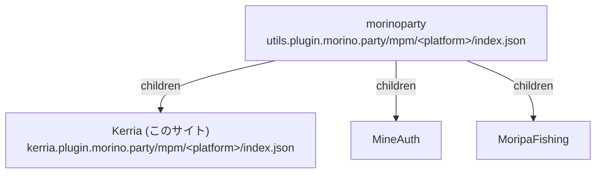

このサイト（`kerria.plugin.morino.party`）は、Minecraft プラグインマネージャー [mpm](https://mpm.plugin.morino.party) のリモートリポジトリとして、Kerria 本体とアドオンの定義を配信します。

## 利用方法

Kerria のリポジトリは、morinoparty のリポジトリ（`utils.plugin.morino.party`）の子リポジトリとして登録されています。
morinoparty のリポジトリを mpm の `config.json` に追加していれば、Kerria とアドオンも自動で参照されます。

```json title="Paper サーバーの config.json"
{
    "type": "remote",
    "url": "https://utils.plugin.morino.party/mpm/paper/index.json"
}
```

```json title="Velocity プロキシの config.json"
{
    "type": "remote",
    "url": "https://utils.plugin.morino.party/mpm/velocity/index.json"
}
```

Kerria のリポジトリだけを使う場合は、`url` に下記の `index.json` を直接指定することもできます。

## リポジトリグラフ

mpm のクライアントは、morinoparty の `index.json` を起点に、`children` に書かれたリンクを再帰的にたどってカタログを組み立てます。



## 配信されるプラグイン

| プラットフォーム | プラグイン | 配布ファイル | 依存 |
|----------------|-----------|------------|------|
| Paper | `Kerria` | `Kerria-paper-<version>.jar` | なし |
| Paper | `Kerria-addon-quickshop-hikari` | `Kerria-addon-quickshop-hikari-<version>.jar` | `Kerria`（必須）、`QuickShop-Hikari` |
| Velocity | `Kerria` | `Kerria-velocity-<version>.jar` | なし |

いずれも GitHub Releases（`morinoparty/Kerria`）から取得されます。
アドオンのバージョンは、既定で Kerria 本体と同じバージョンに揃えられます（`defaultVersion: sync:Kerria`）。

## 配信されるファイル

| URL | 内容 |
|-----|------|
| `https://kerria.plugin.morino.party/mpm/paper/index.json` | Paper 向けのプラグイン定義 |
| `https://kerria.plugin.morino.party/mpm/velocity/index.json` | Velocity 向けのプラグイン定義 |

各 `index.json` はドキュメントサイトのビルド時に `docs/scripts/build-mpm-index.mjs` によって生成されます。

| ファイル | 内容 |
|---------|------|
| `docs/mpm/<platform>/plugins/*.json` | プラグインごとの定義（1 プラグインにつき 1 ファイル） |
| `docs/mpm/<platform>/children.json` | 子リポジトリへのリンクの一覧（現在は空） |

新しいアドオンを追加するときは、`docs/mpm/paper/plugins/` に定義を 1 つ追加するだけで配信されます。morinoparty のリポジトリ側の変更は不要です。
リリース用のワークフローは `addons/` 以下のアドオンを自動で検出し、`Kerria-addon-<name>-<version>.jar` として GitHub Releases にアップロードします。

手元で生成結果を確認する場合は、次のコマンドを実行します。

```bash
cd docs
pnpm run build:mpm-index
```
