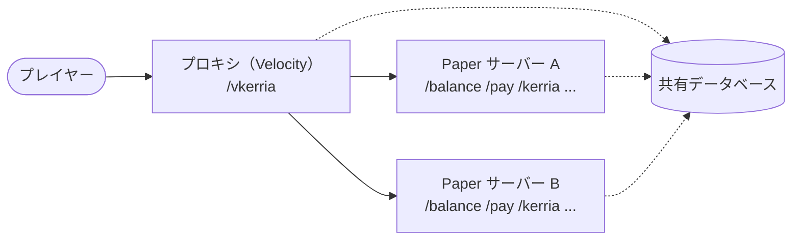

# プレイヤー向けガイド

このセクションでは、Kerria が導入されたサーバーで遊ぶプレイヤーが使える機能を説明します。
サーバーへの導入や設定、API については、サイドバー上部の切り替えから「開発者・管理者向け」を参照してください。

Kerria はサーバー内のお金（通貨）を管理するプラグインです。
自分の残高を確認したり、ほかのプレイヤーにお金を送ったり、これまでの取引を振り返ったりできます。

## 使える機能

| 機能 | コマンド | 内容 |
|------|----------|------|
| [残高確認](/docs/player/commands#balance) | `/balance`・`/bal` | 自分の残高を確認できます。通貨IDを指定すると、その通貨の残高を表示します。 |
| [送金](/docs/player/commands#pay) | `/pay` | ほかのプレイヤーにお金を送れます。`--message` でメモを添えることもできます。 |
| [取引履歴](/docs/player/commands#log) | `/kerria log` | 自分の入出金の履歴をページ送りで確認できます。 |
| [通貨変換](/docs/player/commands#convert) | `/kerria convert` | 管理者が設定した為替レートで、ある通貨を別の通貨に両替できます。 |
| [ランキング](/docs/player/commands#top) | `/kerria top` | 残高の多いプレイヤーを一覧で表示します（デフォルトでは OP のみ）。 |
| [プロキシのコマンド](/docs/player/commands#proxy-commands) | `/vkerria` | ネットワーク全体で使える残高確認・送金のコマンドです（プロキシに Kerria が導入されている場合のみ）。 |

## Paper のコマンドとプロキシのコマンド

Kerria のコマンドには、各サーバー（Paper）で動くものと、プロキシ（Velocity）で動くものの 2 種類があります。
どちらも同じデータベースの残高を参照するため、どのサーバーから確認しても残高は同じです。

- **Paper のコマンド**（`/balance`・`/pay`・`/kerria ...`）は、いま接続しているサーバー上で実行されます。通常はこちらを使います。
- **プロキシのコマンド**（`/vkerria ...`）は、プロキシ上で実行されます。プロキシに Kerria が導入されているネットワークでのみ使えます。

詳しい使い方は [コマンド](/docs/player/commands) を参照してください。
